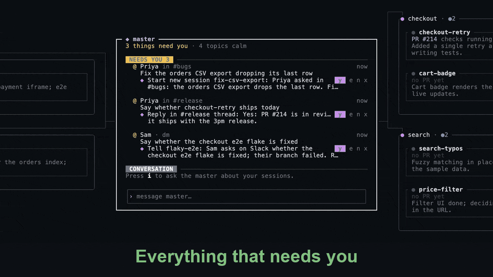

<div align="center">

<a href="https://getserenity.dev"></a>

# serenity

**One calm map for your Claude Code sessions.**

Every session is a node on a mind map around one master agent.<br>
Working agents stay quiet. Waiting agents call you. The master keeps the overview.

[](https://github.com/mukkund1996/serenity/actions/workflows/ci.yml)
[](https://github.com/mukkund1996/serenity/releases)
[](LICENSE)


[**Website**](https://getserenity.dev) · [**Install**](#install) · [**How it works**](#how-it-works) · [**Keys**](#keys) · [**Configuration**](#configuration) · [**Usage and cost**](#usage-and-cost) · [**Docs**](docs/adr/README.md)

<br>



</div>

```bash
curl -fsSL https://raw.githubusercontent.com/mukkund1996/serenity/main/scripts/install.sh | sh
```

<sub>macOS and Linux · [Homebrew and other install options](#install)</sub>

---

## Why serenity

It starts with one Claude session. Then there are six, spread across tmux windows, worktrees and PRs, and you spend your day tabbing between them to find the one that is waiting on you.

serenity puts them all on one keyboard-driven map in your terminal:

- **Harmony instead of clutter.** Every Claude Code session is a node, grouped into topics the master picks for you.
- **Focus instead of distraction.** Working agents stay grey and quiet. An agent that needs an answer turns yellow and moves to the top.
- **Clarity instead of noise.** The master agent summarises every session, suggests the next step, and acts on it when you press `y`.

serenity runs on your existing Claude Code login and subscription ([what it uses](#usage-and-cost)).

> [!NOTE]
> serenity is in **beta**. Expect rough edges and changes between releases.

## Features

| | |
|---|---|
| **Mind map of sessions** | Three zoom levels: the **map** (master in the centre, topics around it), **topics** (every session as a card with its summary and PR), and **session** (the real Claude Code pane, untouched). |
| **Live status** | Sessions report through Claude Code hooks: `◐` waiting, `●` working, `✓` finished. Only waiting sessions ask for attention. |
| **The master** | Haiku writes one-line summaries and groups sessions into topics, Sonnet suggests replies, approvals and cleanups you accept with `y` / `e` / `n`, and an Opus chat (`i` on the master) can see and steer everything, start new sessions from a brief, and relay to any session you tag with `@name`, condensing its answer when you asked a question. Commands in its input: `@new <brief>` starts sessions, `@copy` / `@handover @session` hand work over, `@move @session… <topic>` moves sessions to a topic; the `@` list leads on through each, offering sessions and then topics. |
| **Pull requests** | Each card shows its PR and checks via `gh`. `o` opens it, ready PRs get a review request from CODEOWNERS, and a merged PR finishes the session. |
| **Safe cleanup** | Removing a session checks for uncommitted changes, unpushed commits and PR state before it touches a worktree. |
| **Worktrees** | New sessions get their own git worktree beside the repo, or reuse an existing branch. |
| **Fan-out** | An agent can split its work into new sessions with serenity's `request_sessions` tool. Ask it ("split this into 3 sessions") and they start at once; if it decides by itself, they wait in NEEDS YOU for `y`. They show under the agent that asked, report each finished turn back to it, and cannot fan out again. |
| **Import** | Bring the Claude Code sessions you already have, no tmux needed: `I` on the map, `serenity import` in any terminal, or ask the master ("import my sessions from yesterday"). Past sessions arrive ended and `Enter` resumes one with `claude --resume` in its own folder; ones running in your tmux join in place. |
| **Pinned sessions** | `p` pins a session you reuse: it is never marked finished or cleaned up, and resumes with `claude --resume` when you attach after it ended. |
| **Slack (optional)** | Mentions and DMs that need you to act, at most three, join NEEDS YOU. The master proposes a follow-up from your sessions and PRs: a reply, a message to the session it is about, or a new session. `y` runs it, Enter marks it seen and opens it, `x` dismisses it. Messages you have written after on Slack drop out. Connect it from the welcome panel on first boot, from `Ctrl+,` → Slack › Login, or with `serenity setup slack`; then it's on per repo (`serenity slack on`, or `Ctrl+,` → Slack › This repo). |

## Install

**Requirements:** macOS or Linux, [Claude Code](https://claude.com/claude-code) logged in with a Claude subscription (Pro or Max, or a Team or Enterprise seat) or an Anthropic Console account, [tmux](https://github.com/tmux/tmux) 3.2+, git, and [`gh`](https://cli.github.com), which the first map offers to log in. The install script installs tmux, git, gh and Claude Code if they are missing; logging in is up to you.

```bash
curl -fsSL https://raw.githubusercontent.com/mukkund1996/serenity/main/scripts/install.sh | sh
```

Or with Homebrew (tmux, git and gh come as dependencies):

```bash
brew install mukkund1996/tap/serenity
```

> [!TIP]
> **If you don't have Claude Code yet,** install it first with `brew install --cask claude-code`. Skip this if you already installed it with npm or Anthropic's installer, or you end up with two copies.

**Next:** `cd` into a git repo you work in and run `serenity` ([Quick start](#quick-start)). The install script ends with these steps too.

The install script reads these environment variables:

| Variable | Default | Effect |
|----------|---------|--------|
| `SERENITY_VERSION` | latest release | Install a specific version |
| `SERENITY_INSTALL_DIR` | `~/.local/bin` | Where the binary goes |
| `SERENITY_NO_DEPS` | unset | Set to `1` to skip installing dependencies |
| `SERENITY_DOWNLOAD_BASE` | the GitHub release | An `https://` or `file:///` URL to a directory holding a copy of a release's binaries and `SHA256SUMS`, for mirrors and CI. The checksums come from the same place, so only use a copy you trust |
| `SERENITY_NO_MODIFY_PATH` | unset | Set to `1` to not add the install directory to your shell profile (`~/.zshrc`, `~/.bashrc`, `~/.bash_profile` on macOS, fish's `conf.d`, or `~/.profile`) when it isn't on your PATH |
| `SERENITY_NO_OPEN` | unset | Set to `1` to not open the [docs](https://getserenity.dev/docs/) in your browser when the install finishes. They never open in CI or without a display; the URL is printed either way |

## Install the skill

New to running several sessions? The free [parallel-sessions](plugins/parallel-sessions/) skill gives Claude a worktree per task, safety checks before cleanup and short handover notes, with or without serenity:

```
/plugin marketplace add mukkund1996/serenity
/plugin install parallel-sessions@serenity
```

For claude.ai, build the upload zip with `bun run package:skill` ([details](plugins/parallel-sessions/README.md)).

## Quick start

```bash
cd ~/path/to/your/repo   # a git repo you work in
serenity                 # opens the map for this repo
```

The install script adds its directory (`~/.local/bin`) to your shell profile if it isn't on your PATH yet, so `serenity` works in any new terminal. Set `SERENITY_NO_MODIFY_PATH=1` to leave your profile alone; it then prints the line to add yourself.

`serenity doctor` checks your setup. Press `N` to start a session, `?` for the full keymap.

**First time?** The first map you open starts with **Welcome to serenity**, up to three optional steps: **Import**, when the repo has past Claude Code sessions, then **GitHub** (PRs and checks on your cards, through `gh`) and **Slack** (mentions and DMs that need you; see [PRIVACY.md](PRIVACY.md)). `Enter` does a step, `s` skips it. Logins run in a popup and tokens stay with gh and Claude Code. Redo them later under `Ctrl+,` or with `serenity setup github|slack` ([ADR 0065](docs/adr/0065-setup-logins.md), [0066](docs/adr/0066-welcome-panel-import-step.md)).


Closing it puts you on the tutorial: one session, `learn-serenity`, prompted with "teach me how to use serenity". Press `Enter` on it for a hands-on tour: the map, sessions, NEEDS YOU, the master, PRs and the keys, one step at a time. It runs in the repo itself and changes nothing; press `K` on it when you're done and it won't come back. It only appears once per machine, and never if you already have sessions. Set `"onboarding": false` in the config or `SERENITY_NO_ONBOARDING=1` to skip it. To take the tour again, install the [learn-serenity](plugins/learn-serenity/) plugin (`/plugin install learn-serenity@serenity`) and ask any session "teach me how to use serenity" ([ADR 0062](docs/adr/0062-first-boot-tutorial.md)).

**Already have Claude Code sessions?** Bring them along, whether or not you use tmux ([ADR 0064](docs/adr/0064-import-past-sessions.md)):

```bash
serenity import               # this repo's sessions from the last 14 days, pick which
serenity import --all-repos   # every repo; each goes onto its own repo's map
serenity import --since 2026-11-01 --dir packages/api --yes
```

Or press `I` on the map (`g` in the picker adds every repo), or ask the master: "import my sessions from yesterday". serenity reads Claude's history in `~/.claude/projects` and never changes it. Imported sessions arrive ended, so nothing runs and nothing is spent until you press `Enter` on one: it resumes with `claude --resume` in the folder or worktree it ran in. If a session is still open in another terminal, quit it there (`/exit`) first; serenity won't run one conversation twice. Sessions whose folder was deleted can't resume and are left out. Claudes already running in your tmux join in place, as before.

| Command | What it does |
|---------|--------------|
| `serenity` | Open the map for the git repo you are in |
| `serenity import` | Bring in your existing Claude Code sessions (`--help` for options) |
| `serenity doctor` | Check tmux, claude, git and gh, and who GitHub and Slack are logged in as |
| `serenity setup github` | Log in to GitHub with `gh` (the welcome panel runs this) |
| `serenity setup slack` | Log in to Slack for the master; asks to turn it on for the repo you are in. `serenity slack login` is the same |
| `serenity slack on` / `off` / `status` | Show Slack on this repo's map, or not (`serenity slack on ~/code/app` names another repo) |
| `serenity restart` | Restart the background daemon (sessions keep running) |
| `serenity stop` | Stop the background daemon |
| `serenity version` | Print the version |

## How it works

```
                 ┌────────────── serenity TUI (Ink) ──────────────┐
   you ── keys ─▶│  map  ›  topics  ›  session                    │
                 └───────────────────────┬────────────────────────┘
                                         │ JSON-RPC over a socket
                 ┌───────────────────────▼────────────────────────┐
                 │  daemon   SQLite state · master (Haiku/Sonnet/ │
                 │           Opus via Claude Code) · gh · Slack   │
                 └───────┬───────────────────────────────┬────────┘
                         │ tmux panes                    │ hooks
                 ┌───────▼───────┐  ┌───────────────┐    │
                 │ claude (wt 1) │  │ claude (wt 2) │ ◀──┘ status
                 └───────────────┘  └───────────────┘
```

- Each session is a real `claude` process in its own tmux pane, usually in its own git worktree. Attaching shows you that pane as it is.
- A background daemon owns the state (SQLite), receives status from Claude Code hooks, polls PRs through `gh`, and runs the master.
- The master proposes actions through MCP; nothing runs until you approve it.
- Each agent session also gets a small serenity MCP server, passed with `--mcp-config`, through which it can ask for more sessions (fan-out). Like the hooks, it lives in serenity's own state directory and never touches `~/.claude`.
- One map per repo: serenity is scoped to the repo you launch it in.

The reasoning behind each of these choices is in the [architecture decision records](docs/adr/README.md).

## Keys

serenity is keyboard-only. The footer shows the moves; `?` opens the full list.

| Key | Action |
|-----|--------|
| `←` `↑` `↓` `→` / `WASD` | Move between nodes |
| `Enter` | Attach to a session, or go into the master; on a NEEDS YOU item, mark it seen (a Slack item is also opened; a session waiting on you is attached instead) |
| `i` | Send the focused session a quick message; on the master, open its chat input (`@` tags a session, `Shift+Enter` or `Ctrl+J` starts a new line, `Esc` closes it) |
| `Ctrl+q` | Back to the map from inside a session |
| `z` / `Z` / `Esc` | Zoom out to the map / zoom in / one level up |
| `Ctrl+w` | Focus the master from anywhere |
| `PgUp` `PgDn` | On the master, scroll its conversation back and on (`Shift+↑` `Shift+↓` too) |
| `←` `→` `Home` `End` | In a text field, move the cursor; `Option+←` `→` by a word. `Ctrl+a` `e` `u` `k` and `Option+Backspace` edit as in a shell |
| `Tab` | Jump to the next session that needs you |
| `y` `e` `n` | Approve, edit or decline the master's suggestion |
| `[` `]` | Previous / next topic |
| `N` `I` | New session · import (running in tmux, or from Claude's history) |
| `o` `f` `p` | Open the PR · watch · pin |
| `r` `K` `x` | Rename · kill the agent · clean up, on a session's card (`r` and `K` on its NEEDS YOU row too); on any NEEDS YOU item `x` only dismisses it (until something new happens). A rename keeps the branch and worktree; names are letters, digits, `. _ -`, at most 40, unique in any case, and never a command word (`new`, `copy`, `handover`, `move`) |
| `/` `c` `H` | Search sessions · centre on the master · archived sessions |
| `Ctrl+,` | Settings: base branch, models, max topics, Slack for this repo (`,` on the map too, for terminals without extended keys) |

## Configuration

Config lives in `~/.config/serenity/config.json`. Every field is optional. `Ctrl+,` on the map (or `,`) opens a settings panel for the most-used ones. It saves each change to the file at once, keeping everything else in it, and applies it live where it can ([ADR 0058](docs/adr/0058-settings-panel-and-base-branch.md)).

```json
{
  "models": { "chat": "opus", "summarizer": "haiku", "suggester": "sonnet" },
  "reviewers": ["teammate-login"],
  "maxTopics": 10,
  "baseBranch": "default",
  "repos": { "~/projects/app": { "baseBranch": { "branch": "develop" } } },
  "slack": { "repos": ["~/projects/serenity"] },
  "crashReports": { "enabled": true },
  "onboarding": true
}
```

| Field | Default | Meaning |
|-------|---------|---------|
| `models` | Opus / Haiku / Sonnet | Models for the master's chat, summaries and suggestions |
| `reviewers` | none | Who to suggest for review when CODEOWNERS names nobody |
| `maxTopics` | `10` | How many topics the master groups sessions into |
| `baseBranch` | `"default"` | What new session worktrees branch off: `"default"` (origin's HEAD), `"current"` (the branch the main checkout is on) or `{ "branch": "develop" }` (local first, else `origin/develop`). If it can't be followed, the repo default is used and the panel and New session dialog say why. The dialog's Base field overrides it for one session |
| `repos.<path>.baseBranch` | none | The same, for one repo (`~` allowed); a repo without one follows `baseBranch` |
| `slack.repos` | none | Repos whose maps show Slack mentions and DMs that need you. Easier: `serenity slack on` in the repo, or `Ctrl+,` → Slack, which write this list for you ([ADR 0023](docs/adr/0023-slack-for-the-master.md), [0024](docs/adr/0024-slack-reply-suggestions.md), [0031](docs/adr/0031-slack-joins-needs-you.md), [0034](docs/adr/0034-dismiss-slack-items.md), [0050](docs/adr/0050-needs-you-seen-and-explicit-actions.md)); log in once with `serenity setup slack` |
| `crashReports.enabled` | `false` | File daemon crashes as GitHub issues through your `gh`, scrubbed of paths, tokens and emails, one issue per crash signature ([ADR 0045](docs/adr/0045-daemon-supervisor-crash-reports-recovery.md)). Reports are always kept in `crash-reports/` in the state directory |
| `crashReports.repo` | `mukkund1996/serenity` | Where crash issues go |
| `onboarding` | `true` | Start the `learn-serenity` tutorial on the first map you open ([ADR 0062](docs/adr/0062-first-boot-tutorial.md)); `false` skips it, as does `SERENITY_NO_ONBOARDING=1` |

Model names are anything `claude --model` accepts (an alias like `sonnet` or a full model id). The daemon reads the file when it starts and again whenever the settings panel opens. From the panel, the base branch applies to new sessions; the summarizer and suggester models, max topics and Slack apply at once (the master gets or drops its Slack tools with your next message). `serenity slack on|off` applies at once the same way. The master's chat model changes after `serenity restart`. After editing other fields by hand, run `serenity restart`.

A supervisor restarts the daemon if it crashes, and it picks up where it left off (ADR 0045). State (SQLite, socket, daemon log, crash reports) lives in `~/.local/state/serenity`. Set `SERENITY_HOME` to use another directory.

## Usage and cost

serenity has no API key or model access of its own. Every model call goes through Claude Code with your login, so it counts against your Claude plan's usage limits, or is billed to your Anthropic Console account if that is how Claude Code is logged in. The sessions on the map are ordinary Claude Code sessions and use what they would use anyway; the master's calls come on top:

| Role (`models.…`) | Default | Runs when |
|-------------------|---------|-----------|
| `summarizer` | Haiku | A session replies. One short call per reply (a burst of hook events within 1.5 seconds counts once) writes its summary and picks its topic. |
| `suggester` | Sonnet | A session starts waiting on you or finishes, its question changes, or its PR merges. One call proposes the next step for `y` / `e` / `n`. |
| `chat` | Opus | The master's chat gets a message: one you send with `i`, or serenity's note that a session you asked it to watch has finished. It does nothing between messages. |

**Slack** (off by default) adds calls only while the map of a repo you turned it on for is open: the `summarizer` model reads your mentions and DMs once a minute and when you open the map, the `suggester` model proposes a follow-up for each new item (and again when a session you told about it answers), and the `summarizer` model posts a reply or shares a file you approved.

Status, PRs, cleanup and the map itself use no model. To use smaller models, set them in `~/.config/serenity/config.json` and run `serenity restart`; fields you leave out keep their defaults:

```json
{ "models": { "chat": "sonnet", "summarizer": "haiku", "suggester": "haiku" } }
```

## Development

serenity is TypeScript on [Bun](https://bun.sh) with an [Ink](https://github.com/vadimdemedes/ink) TUI, split into `packages/core`, `daemon`, `tui` and `cli`.

```bash
bun install
bun dev              # run from source with its own state and tmux server
bun run install:local  # build and install to ~/.local/bin for daily use
```

| Command | What it does |
|---------|--------------|
| `bun run test` | Unit and contract tests |
| `bun run test:e2e` | End-to-end in a private tmux server with a fake `claude` |
| `bun run lint` / `bun run format` | Biome |
| `bun run typecheck` | TypeScript |
| `bun run build` | Single binary at `dist/serenity` |
| `bun run install:local` | Build, install to `~/.local/bin/serenity`, restart the daemon |
| `bun dev …` | The CLI from source, isolated state and tmux server |

A new build replaces a running daemon by itself.

**Further reading:** [decision records](docs/adr/README.md) · [screen specs](docs/design/handover.md) · [dogfooding notes](docs/dogfooding.md) · [website source](website/) · [changelog](CHANGELOG.md)

**Releases:** merging the release-please PR on `main` tags a version; the release workflow attaches the binaries and bumps the Homebrew tap ([ADR 0025](docs/adr/0025-install-script-and-homebrew.md)).

## Contributing

See [CONTRIBUTING.md](CONTRIBUTING.md) for setup, checks, ADRs and pull requests. Ask questions and share ideas in [Discussions](https://github.com/mukkund1996/serenity/discussions). Report bugs as [issues](https://github.com/mukkund1996/serenity/issues). Everyone taking part follows the [Code of Conduct](CODE_OF_CONDUCT.md). [PRIVACY.md](PRIVACY.md) says what serenity reads, stores and sends.

## License

[MIT](LICENSE). serenity is an independent open-source project, not affiliated with or endorsed by Anthropic, Slack or Microsoft.
